### 🤖 Seu atendente de WhatsApp com Inteligência Artificial — trabalhando 24h por dia

## ⬇️ **[BAIXAR O INSTALADOR](https://github.com/jeffthiago/omnius-releases/releases/download/v7.0.14/OmniusAI-7.0.14-Setup-PTBR.exe)**

Depois de instalado, o Omnius se atualiza sozinho para a versão mais nova. · <a href="https://github.com/jeffthiago/omnius-releases/releases/latest">Ver todas as versões</a>

---

## ✨ O que é o Omnius AI

O **Omnius AI** conecta a sua **inteligência artificial** (**OpenAI** ou **Google Gemini**) ao **WhatsApp**. Ele conversa com seus clientes de forma **natural e humanizada**, **24 horas por dia** — respondendo dúvidas, agendando, consultando seus sistemas e chamando um humano na hora certa.

> 💡 Tudo roda no **seu computador**, com a **sua chave de IA**. Fácil de instalar, poderoso no atendimento.

---

## ⚡ Como funciona

| 1️⃣ **Instale** | 2️⃣ **Configure** | 3️⃣ **Deixe a IA atender** |
|:---:|:---:|:---:|
| 📥 Baixe e instale em 1 minuto | 🔑 Cole sua chave de IA e conecte o WhatsApp | 💬 Seus clientes são atendidos na hora, 24/7 |

---

## 🚀 Recursos

| | |
|---|---|
| 💬 **IA no WhatsApp** | Respostas naturais e humanizadas, sem parecer robô |
| 🔑 **Sua própria chave** | Use sua conta OpenAI ou Google Gemini |
| 🎙️ **Áudio e voz** | Entende áudios dos clientes e responde também por voz (OpenAI, Gemini ou ElevenLabs) |
| 🧩 **Múltiplas instâncias** | Atenda vários números / setores ao mesmo tempo, cada um com sua IA |
| 🛠️ **Ferramentas de API** | Integre com seus sistemas (consultas, faturas, desbloqueio, estoque...) |
| 📅 **Agenda Google** | A IA consulta horários livres e agenda direto no Google Agenda |
| 👥 **CRM integrado** | Organize contatos, funil de vendas e deixe a IA mover os leads de etapa |
| ⏰ **Follow-up automático** | Retoma conversas paradas no tempo certo, sem esforço |
| 🎯 **Prospecção** | Encontre novos clientes e inicie conversas automaticamente |
| 📚 **Base de conhecimento** | A IA responde usando os seus próprios documentos |
| 🔔 **Notificação humana** | Saiba a hora certa de assumir a conversa — a IA pausa e avisa você |
| 🧪 **Chat de teste** | Teste a IA e as suas ferramentas antes de colocar no ar |
| 🔄 **Atualização automática** | Sempre na versão mais nova, com um clique |

---

## 👤 Para quem é

- 🏢 **Provedores de internet** — 2ª via, desbloqueio, suporte e vendas automatizados
- 🛍️ **Lojas e e-commerce** — tire dúvidas e feche vendas no WhatsApp
- 💼 **Prestadores de serviço** — agende, informe e atenda sem perder cliente
- 🏋️ **Academias, clínicas e consultórios** — agendamentos, matrículas e dúvidas respondidos na hora
- 🚀 **Qualquer negócio** que atende pelo WhatsApp e quer **escalar sem contratar mais gente**

---

## ⬇️ Como instalar

1. 📥 Baixe o instalador pelo botão **BAIXAR O INSTALADOR** acima (ou na seção *Assets* de qualquer versão em **[Releases](https://github.com/jeffthiago/omnius-releases/releases)** — é o arquivo **`.exe`**).
2. ▶️ Execute o instalador e conclua a instalação.
3. 🔐 Abra o **Omnius AI** e faça **login** com a sua conta.
4. 🔑 Configure a **chave de IA**, conecte o **WhatsApp** (QR Code)... e pronto! 🎉

> 🔄 **Atualizações automáticas:** o Omnius avisa sozinho quando sai uma versão nova — é só clicar em **Atualizar** e ele se atualiza em segundos, mantendo suas configurações.

---

## 🆕 Novidades recentes

Veja o histórico completo em **[Releases](https://github.com/jeffthiago/omnius-releases/releases)**. Algumas melhorias das últimas versões:

- 📶 **Conexão mais estável** — o WhatsApp volta a entregar as mensagens por completo depois de reconectar
- 🔑 **Troca de chave da IA vale na hora**, sem precisar recarregar nada
- 🤝 **Despedida na transferência** — o cliente recebe a última mensagem antes de a IA ser pausada
- 🛡️ **Logout não apaga suas Ferramentas de API**

---

## 💻 Requisitos

- 🖥️ **Windows 10 ou 11** (64 bits)
- 🌐 Conexão com a **internet**
- 🔑 Uma **chave de API** da OpenAI ou do Google Gemini
- 📱 Um número de **WhatsApp** para conectar

---

## 🆘 Suporte & Contato

Ficou com dúvida, quer testar ou contratar? Fale com a gente:

### 💬 **[FALAR NO WHATSAPP](https://wa.me/5512982005889)**

---

Feito com 💙 pela equipe <b>Omnius AI</b> · © 2026 · Todos os direitos reservados.

